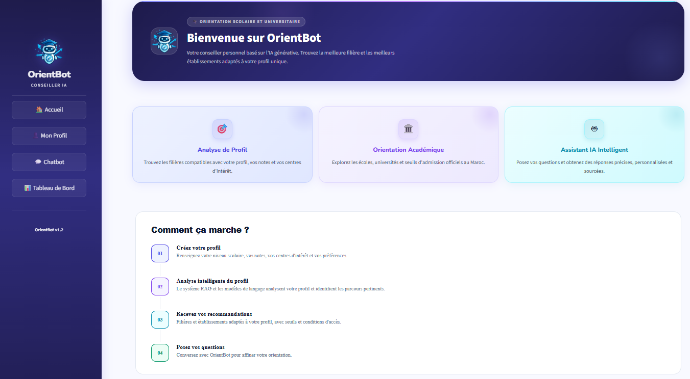
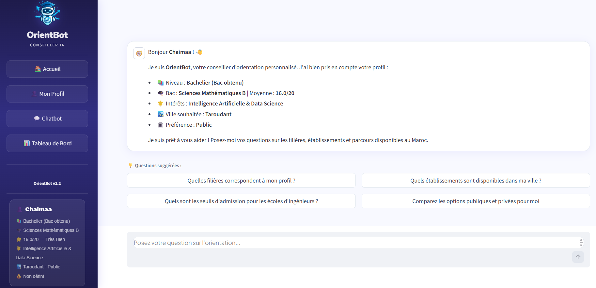

# OrientBot

**Chatbot intelligent d’orientation scolaire et universitaire basé sur l’IA générative et l’approche Retrieval-Augmented Generation (RAG).**

OrientBot est un projet de fin d’études (PFE) réalisé dans le cadre du Master. Il accompagne les élèves et les étudiants dans leurs choix d’orientation au Maroc en proposant des recommandations personnalisées selon leur profil académique, leurs centres d’intérêt et leurs préférences.

## Fonctionnalités principales

- **Personnalisation des recommandations** à partir du profil de l’apprenant.
- **Base de connaissances spécialisée** couvrant les filières, les établissements, les conditions d’admission et les parcours de formation au Maroc.
- **Recherche hybride** combinant recherche vectorielle et recherche lexicale BM25.
- **Fusion des résultats** à l’aide de Reciprocal Rank Fusion (RRF).
- **Re-ranking des documents** avec un Cross-Encoder pour améliorer la pertinence des passages récupérés.
- **Génération augmentée par récupération (RAG)** avec Gemini 2.5 Flash.
- **Interface conversationnelle interactive** développée avec Streamlit.

## Aperçu de l’application

<!-- Ajouter les captures d’écran dans le dossier screenshots/ -->

| Interface d’accueil | Assistant conversationnel |
|:---:|:---:|
|  |  

## Architecture du système

Le système repose sur trois étapes principales :

1. **Préparation et indexation des connaissances :** collecte, nettoyage, structuration et vectorisation des données.
2. **Recherche et classement :** récupération hybride des documents pertinents, fusion des résultats et re-ranking.
3. **Génération personnalisée :** combinaison des documents récupérés et du profil de l’apprenant pour produire une réponse contextualisée.

## 🛠️ Technologies

**Python · LangChain · RAG · Mistral AI · Gemini · Llama · ChromaDB · BM25 · Cross-Encoder · Hugging Face · Pydantic · Streamlit · RAGAS**
